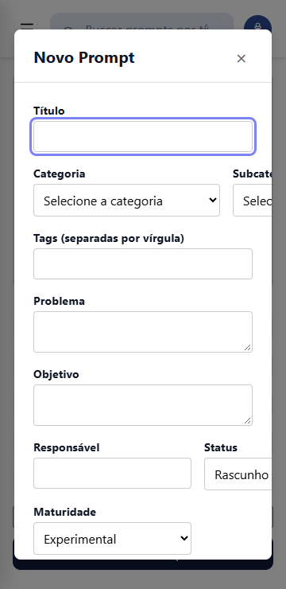
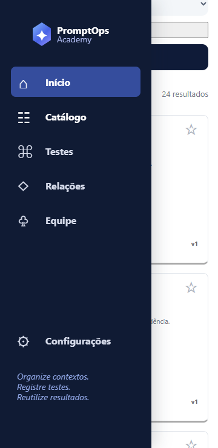
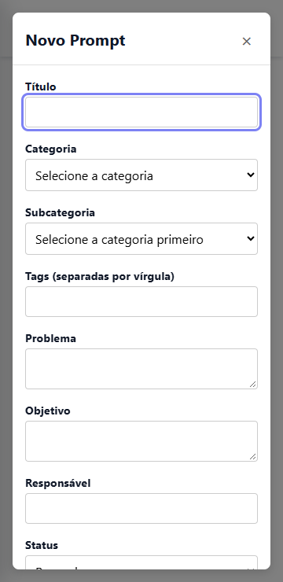
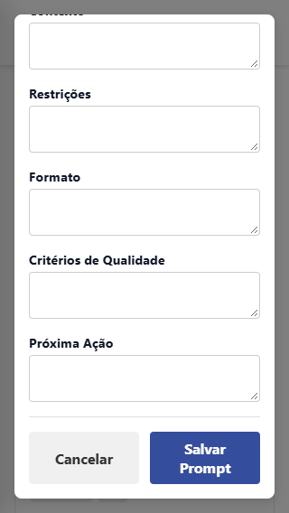
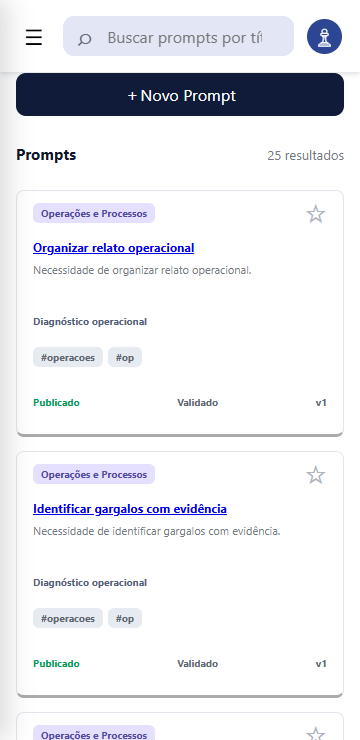
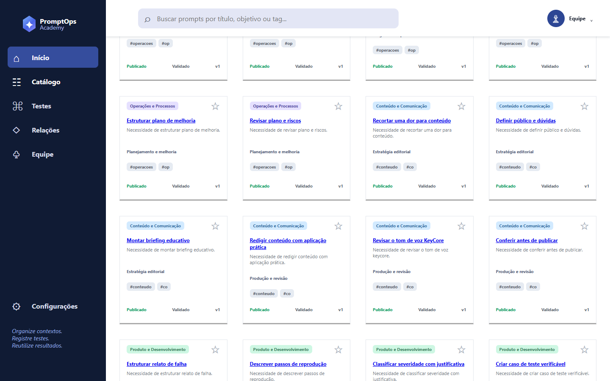

# Issue #31 — ajustes de interface

Validação em 21/10/2026. Base: `a12b07e` de `upstream/main`.
Branch: `fix/issue-31-responsividade-interface`.

## Escopo

- Novo Prompt: uma coluna até 700 px, controles limitados à largura disponível, modal com altura dinâmica e rolagem para alcançar todos os campos e botões.
- Menu mobile: fecha ao tocar fora, ao selecionar um link e com Escape; limpa o estado ao mudar para desktop. Estado e rótulo acessíveis acompanham o fechamento. Aplicado aos módulos usados no catálogo e no detalhe.
- Barra superior: acompanha a rolagem com `position: sticky; top: 0`, mantendo a hierarquia abaixo do menu e do modal.

Os arquivos de cadastro, validação, persistência e dados não foram alterados. Cópia de prompts e navegação do Laboratório ficam fora deste ajuste.

## Reprodução antes do ajuste

Em 360 × 740, a área interna do modal media 324 px, mas o conteúdo exigia 527 px. O menu permanecia aberto depois de um clique fora. Após rolar 600 px, a posição superior da barra era −600 px.




## Verificação depois

Chrome headless 156.0.8078.47 com Playwright, em viewports em pixels CSS:

| Viewport | Formulário e botões | Barra superior | Validação e persistência |
|---|---|---|---|
| 320 × 568 | Aprovado | Aprovado | Aprovado |
| 360 × 740 | Aprovado | Aprovado | Aprovado |
| 412 × 915 | Aprovado | Aprovado | Aprovado |
| 700 × 800 | Aprovado | Aprovado | Aprovado |
| 701 × 800 | Aprovado | Aprovado | Aprovado |
| 1440 × 900 | Aprovado | Aprovado | Aprovado |
| 915 × 412 | Aprovado | Aprovado | Aprovado |

Em cada tamanho, verificou-se que não há transbordamento horizontal no modal, que todos os campos e botões podem ser alcançados pela rolagem, e que o formulário usa uma coluna no mobile e duas no desktop. A barra permanece em `top: 0` após rolar.

Nos quatro tamanhos até 700 px, o menu passou nos cenários de toque fora, link, Escape e retorno de desktop para mobile. O fechamento por toque fora também foi validado na página de detalhe.

Em todos os tamanhos, o catálogo carregou os 24 prompts. O título curto foi bloqueado pela validação nativa, sem gravação; um registro fictício válido foi salvo e recuperado no catálogo após recarregar. Os contextos de navegador dos testes são descartados ao final. Nenhum erro JavaScript de página foi detectado.






Resultados estruturados: [resultados.json](evidencias/issue-31/resultados.json). As demais capturas estão na mesma pasta.

## Como repetir

Com Node, Playwright e Google Chrome disponíveis, executar na raiz:

```sh
node tests/issue31-ui.cjs
node --test tests/*.test.js
```

O teste de interface atende os arquivos locais por interceptação de requisições em `http://promptops.test`, sem depender de servidor nem de rede. Nesta sessão, o acesso do navegador ao servidor de loopback foi bloqueado. Os testes simulam toque e tamanhos mobile; não foram executados em aparelho físico nem em Safari. Teclado virtual real ainda requer conferência no aparelho.

Também passaram a validação de sintaxe de todos os arquivos em `js/`, leitura do JSON e `git diff --check`. A suíte existente passou: 5 verificações de navegação e 3 testes smoke.

## Revisão

A entrega deve seguir por PR para `KeyCoreSH/promptops-academy:main`. Conforme o README, somente `@rogerin` pode aprovar e liberar a alteração. Não realizar merge direto.
